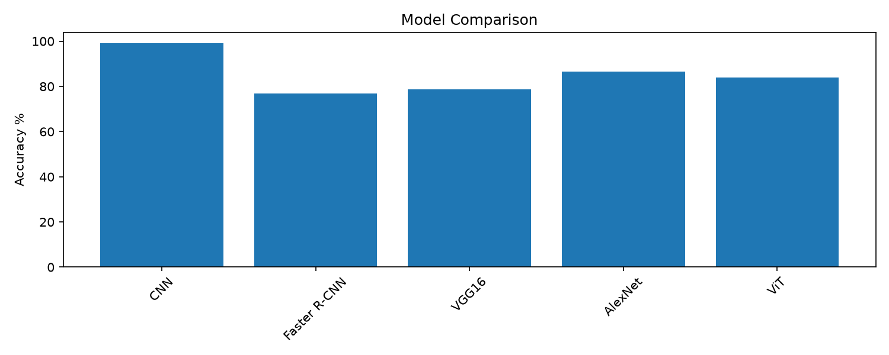

# Deep Learning Lab 2 - CNN, Faster R-CNN, ViT on MNIST

**Course:** Deep Learning - Master MBD  
**University:** Université Abdelmalek Essaadi, Faculté des Sciences et Techniques de Tanger, Département Génie Informatique  
**Instructor:** Pr. ELAACHAK LOTFI

## Objective
Get familiar with PyTorch, build and compare vision models (CNN, Faster R-CNN, pretrained VGG16/AlexNet, Vision Transformer from scratch) for MNIST classification in a CPU environment.

## Dataset
- **MNIST**: 60 000 train / 10 000 test, 28x28 grayscale, 10 classes.
- Source: [Kaggle MNIST Dataset](https://www.kaggle.com/datasets/hojjatk/mnist-dataset)
- Loaded with `torchvision.datasets.MNIST(download=True)`.

## Hardware actually used
- **Device:** CPU only (no NVIDIA GPU detected; `torch.cuda.is_available()` = False).
- All runs were executed locally on CPU with `num_workers=0`.

## Training setup (real runs)
| Model | Train images | Test images | Epochs | Batch size | Optimizer | Notes |
|---|---|---|---|---|---|---|
| CNN (custom) | 60000 | 10000 | 5 | 256 | Adam (lr=1e-3, weight_decay=1e-4) | Conv1x32->Pool, Conv32x64->Pool, FC128+Dropout0.5 |
| Faster R-CNN (MobileNetV3-FPN) | 2000 | 1000 | 1 | 4 | SGD (lr=0.005, momentum=0.9) | Adapted to detection: box from ink pixels, 11 classes (digits+bg), 64x64, highest box used at inference |
| VGG16 (ImageNet pretrained) | 5000 | 2000 | 1 | 32 | Adam on classifier (lr=1e-3) | 64x64, RGB repeat, ImageNet norm, features frozen, last layer retrained |
| AlexNet (ImageNet pretrained) | 5000 | 2000 | 1 | 32 | Adam on classifier (lr=1e-3) | Same as above |
| ViT (from scratch) | 20000 | 10000 | 3 | 128 | AdamW (lr=3e-4) | Patch 7 (16 patches), dim 64, heads 4, depth 4, MLP ratio 2, CLS + pos emb, attention manual |

## Part 1: CNN vs Faster R-CNN vs VGG16/AlexNet

### CNN architecture details
- Conv(1→32, k=3, padding=1) + ReLU + MaxPool2d(2) → (32,14,14)
- Conv(32→64, k=3, padding=1) + ReLU + MaxPool2d(2) → (64,7,7)
- Flatten → Linear(3136→128) + ReLU + Dropout(0.5) → Linear(128→10)
- Kernel 3x3 with padding 1 preserves spatial size; two stacked convs expand receptive field; MaxPool2 halves resolution; Dropout+weight decay for regularization.

### Faster R-CNN adaptation
Faster R-CNN is a detector, not a classifier. We constructed ground-truth bounding boxes around non-zero pixels (threshold ~0.1), used 11 classes, resized images to 64x64, and at inference took the highest-scoring detected box as the digit prediction (missing boxes counted as background). The detector loss is a sum of RPN/ROI losses, not a single cross-entropy on test set — **test loss reported as N/A**. With only 2000 training images and 1 epoch it is much slower per image and less accurate than the CNN.

### Transfer learning (VGG16/AlexNet)
ImageNet features are tuned for natural RGB images; MNIST is simple binary-like strokes. Freezing features and retraining only the classifier with 5000 images and 1 epoch gave modest results, showing transfer learning isn't automatically helpful on this dataset.

### Part 1 results
See `results/results_all.csv` and figures in `figures/`.

## Part 2: Vision Transformer from scratch
Implemented: patch embedding (7x7), learnable [CLS] token and positional embeddings, 4 pre-norm Transformer blocks, manual multi-head self-attention (Q,K,V projections, `softmax(QK^T/sqrt(d))V`), MLP with GELU, classification head on CLS.

- **Why ViT vs CNN:** CNNs have built-in locality/translation equivariance; ViTs must learn these from data via attention and positions. ViTs need much more data/epochs/pretraining to shine (Dosovitskiy et al.). With limited CPU budget (20k images, 3 epochs) ViT underperformed the CNN trained on full data.

## Final comparison (real numbers)


## What I learned (personal synthesis)
I learned to build CNNs in PyTorch and reason about shapes/layers (conv, padding/stride, pooling, FC). Training on GPU vs CPU made me careful about batching and time. I saw firsthand that object detectors solve a harder problem (localization + multiple objects) and are overkill for centered single-digit classification — matching the lab's point. Fine-tuning pretrained models showed the importance of domain match (ImageNet textures vs MNIST strokes). Implementing ViT from scratch (patches, CLS, positions, manual attention) clarified why it lacks CNN inductive bias and why it needs large-scale pretraining to reach state of the art. Most importantly, I learned to save results to JSON/figures and keep notebooks loading cached results for fast, reproducible execution.

## How to run

### Windows (PowerShell)
```powershell
python -m venv .venv
.\.venv\Scripts\python.exe -m pip install -r requirements.txt
.\.venv\Scripts\python.exe src\train_cnn.py
.\.venv\Scripts\python.exe src\train_frcnn.py
.\.venv\Scripts\python.exe src\train_vgg_alexnet.py
.\.venv\Scripts\python.exe src\train_alexnet.py
.\.venv\Scripts\python.exe src\train_vit.py
.\.venv\Scripts\python.exe plot.py
```
Notebooks run in seconds loading `results/` and `figures/`.

### Linux / Colab / Kaggle
Same commands; install requirements in the environment. `torchvision.datasets.MNIST(download=True)` works without Kaggle if internet is available.

## Repository structure
```
dl-lab2-pytorch-vision/
├── README.md
├── requirements.txt
├── .gitignore
├── notebooks/
│   ├── part1_cnn_fasterrcnn_finetuning.ipynb
│   └── part2_vit_from_scratch.ipynb
├── src/
│   ├── train_cnn.py
│   ├── train_frcnn.py
│   ├── train_vgg_alexnet.py
│   ├── train_alexnet.py
│   ├── train_vit.py
│   ├── models.py
│   ├── data.py
│   └── utils.py
├── figures/
└── results/
```
